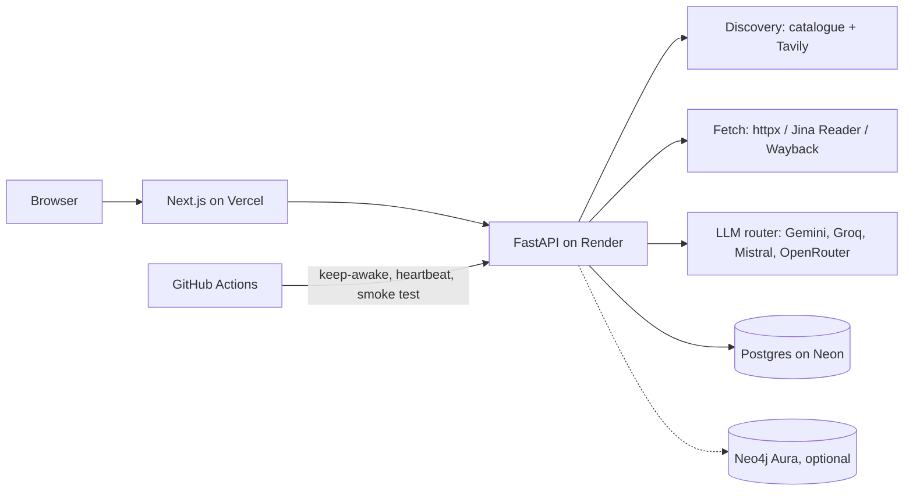

# Ritam

**Banks talk. Ritam checks.**

Ritam finds the gaps in what you're told about a financial product. Name a credit card, ask a question,
and Ritam gathers the bank's pages, terms documents and third-party sites, then shows:

- where sources **disagree** (and whether the bank disagrees with itself)
- figures that are **out of date** on comparison sites
- terms RBI requires in a card's MITC that are **missing or unclear**
- changes announced with **less notice** than RBI's one-month rule
- what customer care **told you** versus what the terms said on that date
- parts of your question **no source answers**

Every finding links to the exact sentence in the source document, highlighted. A ranked
"Verify next" checklist tells you what to check and where.

Live demo: _link added after deployment_

## How it decides

The AI reads; code decides.

1. **Find sources.** A checked catalogue of popular cards, then web search (Tavily)
   for anything else. Each source is tagged official or third-party by its domain
   (`*.bank.in`, issuer and RBI domains). You confirm the list before the audit.
2. **Fetch.** httpx, then a rendered page for JavaScript-heavy sites, then the Wayback Machine.
   PDFs, saved pages and pasted chats work too; personal details in chats are masked first.
3. **Extract.** An LLM proposes claims, each with a quote. A claim is kept only if the quote is
   found in the document (exact or number-safe fuzzy match) and every number in the value appears
   in that quote.
4. **Analyse.** Fixed rules compare normalised values (₹, lakh/crore, % per month vs per year,
   counts per quarter vs per year) and produce findings labelled **Sourced**,
   **AI suggestion** or **Uncertain**.
5. **Explain.** A short AI summary that may only cite real findings; it's rejected if it invents
   a number.

## Architecture



- **Backend:** Python 3.13, FastAPI, SQLAlchemy 2 (async), Alembic, Pydantic v2
- **Frontend:** Next.js 15, React 19, Tailwind CSS 4, Radix UI
- **Data:** Postgres (claims, findings, audit trace), Neo4j (optional graph projection)
- **AI:** free tiers only, with per-provider daily budgets and automatic fallback
- **Quality:** 170 tests, mypy strict, ruff, CI on every push

## Example audits

The app ships with three audits built from real public documents:

| Audit | What it shows |
|---|---|
| Axis Bank Magnus | DCC markup conflict between a press report and the bank's notice; notice period check |
| HDFC Millennia | Customer-care claim vs written fee waiver; outdated figure on a comparison site; an old link that now opens a different card |
| ICICI Amazon Pay | MITC terms that are mentioned but unclear |

## Run locally

Requirements: Python 3.12+, Node 20+, a Postgres database.

```bash
cp .env.example .env          # add DATABASE_URL and at least one LLM key
cd backend
python -m venv .venv && .venv/Scripts/activate   # macOS/Linux: source .venv/bin/activate
pip install -e ".[dev]"
alembic upgrade head
uvicorn app.main:app --reload
```

```bash
cd frontend
npm install
npm run dev                   # http://localhost:3000
```

Optional: `python -m app.seed --demo-dir ../demo-docs` rebuilds the example audits.

Tests: `pytest` in `backend/`. Database tests run when `RITAM_TEST_DATABASE_URL` points at a
separate database.

## Limits

Ritam reports possible gaps, not verdicts, and it is not financial advice. It only knows what
the sources it read say; the bank's latest MITC is the final word.

## Future scope

Personal loans (Key Fact Statement and APR checks), scholarships and government schemes, more languages, listen-aloud summaries,
downloadable reports.
