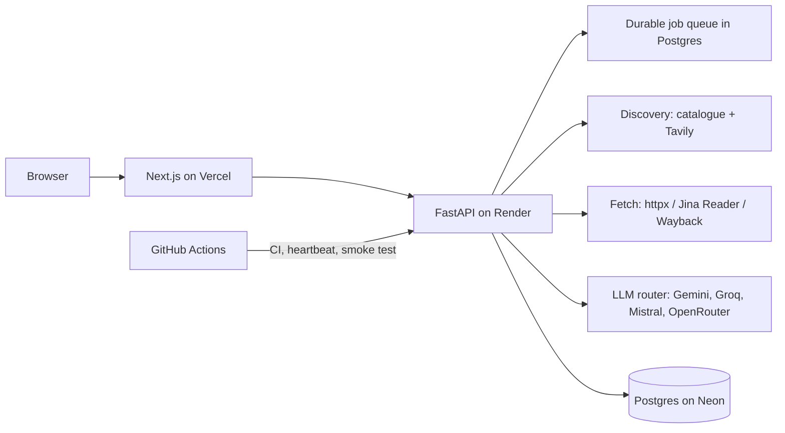

# Ritam

**Banks talk. Ritam checks.**

Ritam helps people in India check what their bank tells them, and get it fixed when it's wrong.
Every finding points to the exact line it rests on: in the bank's own documents, in your bill, and
in RBI's rules.

Live: https://ritam-ten.vercel.app

## What it does

- **Something went wrong?** Describe the problem in your own words, typed or spoken, in English or
  Hindi. Ritam works out what kind of problem it is and takes you to the right check. A payment
  you didn't make always goes straight to "block the card, call 1930".
- **Check my bill.** Upload a statement PDF. Ritam lists every fee, interest charge and GST amount,
  and flags the ones worth raising: a late fee charged inside RBI's 3-day grace, an over-limit fee
  without consent, interest on a "no cost" EMI, a purchase charged twice, a fee on a card sold as
  lifetime free. With last month's bill too, it also checks the late fee against the right due
  date, interest after a full payment, a cut credit limit and missing reward points.
- **Complaint letter.** Each finding becomes a letter with the bill line, the amount and the RBI
  paragraph, plus where to send it (from the bank's own documents) and the dates that matter:
  when the bank must reply, and the window for the RBI Ombudsman, as calendar reminders.
- **Card not closed.** Works out the ₹500-a-day penalty after 7 working days and writes the claim.
- **What changed on my card.** A card's terms when you got it next to today's, dated from the
  bank's own documents.
- **Card report.** Name a card and ask a question. Ritam reads the bank's pages, terms documents
  and comparison sites, and shows where they disagree, what's out of date, what RBI requires but
  is missing, and changes made with less than a month's notice.
- **Easier reading.** Listen aloud, larger text, high contrast, save as PDF.

## How it decides

The AI reads; code decides.

1. **Read.** An AI proposes facts: a card's terms with a quote each, or a bill's charges.
2. **Check.** Code keeps a fact only if the document confirms it. A quote must be found in the
   document and every number in it must appear there. A bill charge must be printed on a dated
   line that also names that kind of charge. Dates and totals must be printed on the bill.
3. **Decide.** Fixed rules, each citing the RBI paragraph it rests on, produce the findings.
   Rules are dated: a 2016 bill isn't judged by the 2022 card rules as if they applied.
4. **Privacy.** Only bill lines with dates, amounts and charge words are sent to the AI, so names
   and addresses are left out, and card numbers, phone numbers and emails are masked first.
   Bills are not stored. Reports that include your own chat or upload stay private to their link.
5. **India only.** Cards and bills from banks outside India are refused before any AI call.

## Architecture



- **Backend:** Python 3.13, FastAPI, SQLAlchemy 2 (async), Alembic, Pydantic v2
- **Frontend:** Next.js 15, React 19, Tailwind CSS 4
- **Jobs:** reports run on a Postgres job queue with leases and retries, so a restart or deploy
  doesn't lose them. It sends no queries while idle, so the database can sleep.
- **AI:** free tiers only, with per-provider daily budgets and automatic fallback
- **Quality:** 240+ tests, mypy strict, ruff, CI on every push, and two accuracy test sets run in CI
  without AI calls (recorded answers): bills (charges found, dates and totals, no false alarms,
  nothing personal sent to the AI) and the problem router (including every fraud message)

## Run locally

Requirements: Python 3.12+, Node 20+, a Postgres database.

```bash
cp .env.example .env          # add DATABASE_URL and at least one LLM key
cd backend
python -m venv .venv && .venv/Scripts/activate   # macOS/Linux: source .venv/bin/activate
pip install -e ".[dev]"
alembic upgrade head
uvicorn app.main:app --reload
```

```bash
cd frontend
npm install
npm run dev                   # http://localhost:3000
```

Tests: `pytest` in `backend/`. Accuracy test sets: `python -m evals.bills` and
`python -m evals.triage`; add `--live --record` to re-ask the AI for bills without a recording.

## Limits

Ritam reports possible problems, not verdicts, and it is not financial advice. It only knows what
the documents it read say. The bill test set is mostly synthetic; real bills with fees are the
next thing to add. A few RBI references (the 2021 Ombudsman window, credit report complaints,
recovery agents) are marked in the app as not yet checked against RBI's own text.

## Next

Full Hindi pages, cost and carbon per report, more real bills in the test set, and personal loans
(Key Fact Statement and APR checks).
